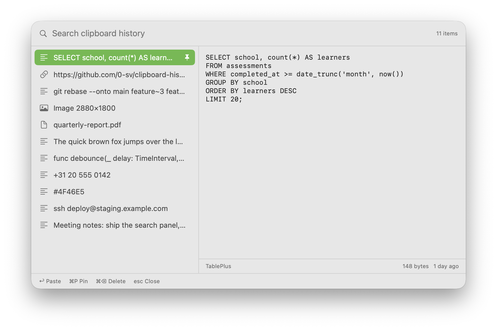

# ClipHistory

A menu bar app for macOS that keeps an unlimited clipboard history. It stores text, images, and file references in a local SQLite database and never deletes them by age or count.



## Use

| Key | Action |
|---|---|
| ⌥V | Open or close the history |
| Type | Search (substring match, not case-sensitive) |
| ↑ / ↓ | Move the selection |
| ↩ | Paste the selected item into the front app |
| ⌘P | Pin or unpin the item |
| ⌘⌫ | Delete the item |
| esc | Clear the search, then close |

The menu bar icon has the other commands: pause the capture, launch at login, delete the last 15 minutes, and clear the history.

## Build

```bash
swift test            # store tests
./build.sh            # build/ClipHistory.app
./build.sh install    # copy to ~/Applications and start
```

The paste step needs the Accessibility permission. Without it, ClipHistory puts the item on the clipboard and you press ⌘V.

`build.sh` signs with your Apple Development certificate if the keychain has one, so the Accessibility permission stays valid after a rebuild. Without that certificate it uses an ad hoc signature, and you must grant the permission again after each rebuild.

## Data

- Database: `~/Library/Application Support/ClipHistory/history.sqlite`
- Images: `~/Library/Application Support/ClipHistory/images/`

The data is not encrypted. ClipHistory skips entries that carry an nspasteboard.org concealed or transient marker. It also skips copies made while an ignored app is in front. Change the ignored apps with:

```bash
defaults write dev.sv.ClipHistory ignoredBundleIDs -array com.bitwarden.desktop com.example.other
```
